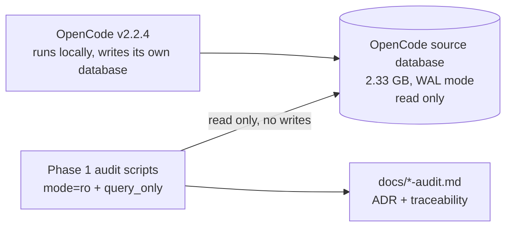
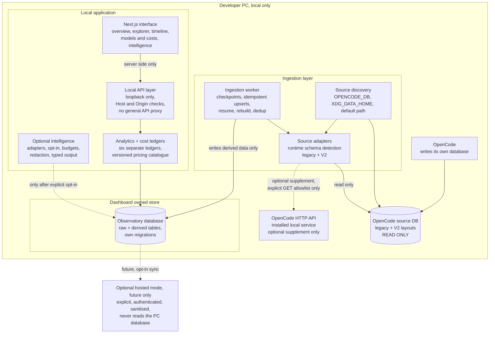

# System diagram

## What runs today

Phase 1 is an audit. The only runtime component is the OpenCode application
itself, plus the read-only inspection the audit performed.

## Planned architecture

Accepted in [`architecture-decision-record.md`](architecture-decision-record.md).
Everything below is planned and not implemented yet.

## Boundaries that must hold

- The source database is opened read-only and is never migrated, vacuumed or
  written.
- The OpenCode HTTP API is used only through an explicit GET allowlist, never
  proxied.
- The local API layer binds loopback, validates Host headers and applies Origin
  checks to its state-changing routes; it is not limited to GET.
- The dashboard database can be deleted and rebuilt without touching the
  source.
- The local server binds loopback by default and rejects foreign Host headers.
- AI providers receive nothing until the user configures a model and asks for a
  summary, and only after redaction.
